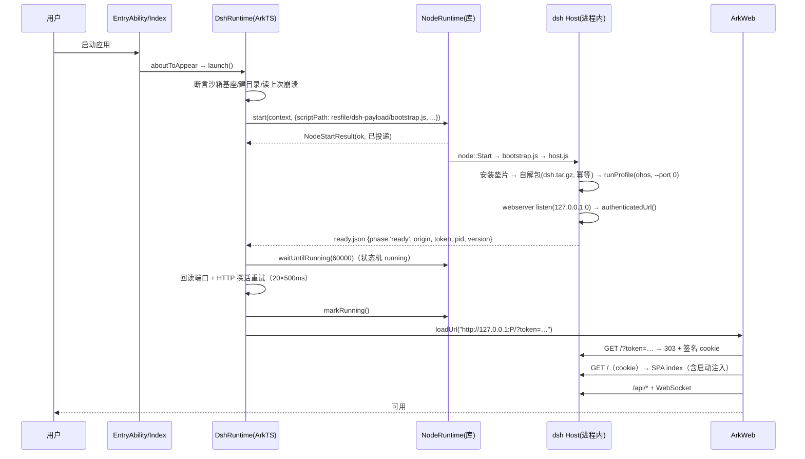

# DSH Desktop · HarmonyOS Edition — 工程规划

> 文档编号：`docs/000-工程规划.md`
> 版本：v0.1（规划稿）
> 状态：**规划中**（未开工；P0 门禁未验证）
> 日期：2026-10-18
> 上游基线：`deepseek-harness` **tag = `dsh-v0.2.1-rc.2`**（`@deepseek-ai/dsh` 0.2.1-rc.2，`engines.node = ^22.19.0 || >=24.0.0`）
> 运行时基线：`ohos-node-bridge` **Node v24.2.0**（`libnode-arm64.so`，SHA-256 锁定）
> 参考工程：`dsh-desktop`（Electron 桌面壳，Windows / Linux / macOS）、`dsh-desktop-hos`（**Electron on HarmonyOS Edition**，能力对标基线）、`pi-desktop-ark`（HarmonyOS Edition，ArkWeb + 进程内 Node 架构参考）

---

## 0. 速览（一页纸）

**做什么**：在 HarmonyOS / OpenHarmony 上交付一个 deepseek-harness 桌面应用。UI **100% 复用上游 dsh Web 前端**（不改 UI、不 fork），Host 是**真正的 Node.js**（进程内 `dlopen libnode.so` + `node::Start`），渲染用**系统 ArkWeb**。不用 Electron，不打包 Chromium。

**能力目标**：与 `dsh-desktop-hos`（Electron 37 路线）**功能对齐**——对话/工具调用、命令执行、文件读写与搜索、会话持久化与全文搜索（better-sqlite3 兜底）、图片附件、**三主目录**（沙箱/文档/下载；「桌面」已按 ACL 结论移除）工作区选择、通知、`dsh-market` 插件市场（内置、不预装第三方插件）、运行时插件安装（内置纯 JS pnpm）；以 **AppGallery 上架** 为终态目标，并保留一条 `--jitless` 兜底发行线。

**核心机制（三条）**：
1. **同源数据面**：Node 内启动 dsh Host（`webserver` 绑 `127.0.0.1:0`）→ 拿到带一次性 token 的 `authenticatedUrl` → ArkWeb `loadUrl()` 同源加载 → token 换签名 cookie → 页面走 `/api` + WebSocket。**零 CORS、零头改写、零自定义协议。**
2. **适配层在上游扩展点里**：新增一个 `ohos` profile + 自有 bundle（YAML patch 层），把 dsh 的能力 seam（`ctx.subprocess` / `ctx.shell` / `ctx.sandbox` / `ctx.directoryPicker` / `ctx.fs`）换成 OHOS 实现。上游 **零源码补丁** 为设计目标，平台性缺陷走**带标记的 payload 垫片**。
3. **宿主能力走同进程桥**：ArkTS 与 Node 之间用 `ohos-node-bridge` 的 `HostBridge`（文件信箱，实测 ~2 ms）；**不向网页注入 preload**，桌面能力全部由 Host 侧插件经 RPC 提供。

**最大风险**：ArkWeb 到 `127.0.0.1` 是否放行（G1）、`node:sqlite` 是否含 FTS5（G2）、运行时装包在无 symlink/hardlink 的沙箱里能否跑通（G6）、NAPI addon 能否在 libnode 上加载（G9）。四者列为 **P0 门禁**，先做 spike 再定版。

---

## 1. 项目概述

### 1.1 一句话定位

`dsh-desktop-ark` 是 **DSH Desktop 的 HarmonyOS Edition**（与 `dsh-desktop-hos` 的 **Electron on HarmonyOS Edition** 并列，二者共用同一份零改动 Web UI 与同一条同源数据面，差别只在「由哪个运行时提供 Node」）：ArkTS（UIAbility + ArkWeb）负责窗口与系统能力，Node（进程内）负责 dsh Host，两者通过一个薄桥连接，业务数据全部走 loopback HTTP + WebSocket。

### 1.2 与既有工程的关系

| 工程 | 定位 | 与本工程的关系 |
|---|---|---|
| `deepseek-harness`（子模块，tag `dsh-v0.2.1-rc.2`） | 上游产品与运行时 | **唯一上游**。只消费其 `bundle` / `profile` / seam 扩展点与公开 API；不在源码里留改动 |
| `ohos-node-bridge`（子模块） | ArkTS 组件库 + 运行时产物缓存 | **运行时依赖**。以 `file:` 依赖消费其 HAR 构建产物；运行时二进制走其 `provision.mjs` 投放 |
| `ohos-node-runtime`（现位于 `ohos-node-bridge/runtime/`） | Node 运行时产物本地仓库（`libnode-arm64.so` + `SHA256SUMS` + `PROVENANCE.md`） | 供 `provision.mjs` 读取；**唯一事实源**是 `ohos-node-bridge/runtime.lock.json`（版本 / SHA-256 / 门禁）。二进制不入库 |
| `pi-desktop-ark` | 另一款产品的同型壳（已落地） | **架构参考**：壳骨架、启动编排、载荷自解包、宿主桥、ACL/取证方法可直接借用；业务语义全部重写 |
| `dsh-desktop-hos` | dsh 的 Electron 37 鸿蒙版（已落地） | **能力对标基线 + 踩坑词典**。本工程要"它有的能力我都有"，但换掉 Electron 运行时 |
| `dsh-desktop` | dsh 的 Electron 桌面版 | **壳契约参考**：`apps/desktop-host` 的启动/就绪/注入/关闭语义是本工程 Node 入口的直接蓝本 |
| `dsh-market` | 插件市场前端/索引 | 随载荷内置，走 dsh 插件管理器 |

### 1.3 目标与非目标

**目标（按优先级）**
1. 真机上跑通完整 dsh Web UI：新建会话 → 流式回复 → 工具调用可视化 → 重启后会话仍在。
2. 能力对齐 `dsh-desktop-hos`（见 §9 矩阵），差异逐条登记而非"看起来能用"。
3. 上游零源码补丁；升级上游 tag 只需重跑产物管线 + 回归。
4. 满足 AppGallery 上架前置（ACL 授权面、AI 合规、隐私、包体）。

**非目标（本期明确不做）**
- 不 fork / 不改写 dsh Web 前端，不做 ArkUI 原生聊天界面。
- 不做 phone 形态（`deviceTypes: 2in1 / tablet`），不做 x86_64 模拟器（沿用运行时决策：只真机）。
- 不做 PTY 真终端（平台无 `/dev/ptmx`），只做非 PTY 命令执行。
- 不自建 Node 交叉编译链（沿用 `electerm/ohos-node-shared` 产物）；但 **better-sqlite3 的 aarch64-ohos 产物由本仓库自建**（§8.3，只在 G2 未过时启用）。
- 不做多实例/多窗口；单实例 `singleton`。

### 1.4 术语

| 术语 | 含义 |
|---|---|
| Host | dsh 的 Node 侧进程内应用（`runProfile` 返回的 Cordis 应用），提供 `webserver` + `/api` + `connection` |
| profile | `$DSH_HOME/profiles/<name>` 下的具名组装，本工程新增 `ohos` |
| bundle | 组合包：`package.json` 的 `dsh.bundle.patch` 指向的 YAML patch 层 |
| seam | 可替换能力（`ctx.subprocess`、`ctx.shell`、`ctx.sandbox`、`ctx.directoryPicker`…） |
| 载荷（payload） | 随 HAP 分发的 Node 侧产物：dsh 生产依赖树 + `ohos` profile + 本工程插件 + pnpm |
| 垫片（shim） | 在 Node 入口最早期安装的运行时补丁，用于抹平平台缺陷（`fs.link` 等），**必须带标记与自检** |
| 宿主桥 | ArkTS ↔ Node 的 RPC 通道（`HostBridge`：原生泵 / 文件信箱） |

---

## 2. 事实基础（读码结论，不是设想）

> 本节每条都可回溯到源码或文档；后续设计只允许在此事实上推导。

### 2.1 上游启动模型（`dsh-v0.2.1-rc.2`）

- 运行中的 `dsh` 是一棵 Cordis 插件树；**profile** 列出有序组合包，**bundle** 通过 `package.json#dsh.bundle.patch` 声明 patch 文件。
- 应用入口只有 `dsh` launcher + 具名 profile（`web` / `headless` / `sdk` / `sdk-minimal` / `acp`）；桌面端是"Electron 壳 + 私有 Host + web profile"。
- 桌面 Host 的真实启动调用（`apps/desktop-host/src/index.ts`）：
  ```ts
  const profile = loadProfileDirectory('dsh', projectDir, installAnchor)   // 已初始化的 profile 目录
  reportSkippedBundles('dsh', profile)
  const application = runProfile({
    environment: loadLayeredEnv('dsh'),
    profile: 'desktop',
    resolvedProfile: { profile, installAnchor },
    patchFiles: [],
    args: ['--no-open', '--host', '127.0.0.1', '--port', '0'],
  })
  ```
- 就绪上报（同一文件，`index.ts:103`）：
  ```ts
  const { ctx } = await application
  const url = ctx.connection.authenticatedUrl(`${ctx.webServer.protocol}//127.0.0.1:${ctx.webServer.port}`)
  send({ type: 'ready', url, injections: ctx.webServer.collectIndexInjections() })
  ```
  `url` 形如 `http://127.0.0.1:<port>/?token=<一次性令牌>`。
- **鉴权模型**（`packages/client/connection`）：每进程一个随机启动令牌；`GET /?token=…` 由 `frontend-static` 交给 `ctx.connection.authorizeIndex` → **303 重定向 + 绑定 host:port 的签名 cookie**（`HttpOnly`、`SameSite=Strict`、默认 30 天）→ 之后 RPC/WS 只认 cookie。静态资源公开；`index` 之外的未授权请求 401；特权方法额外要求 **loopback authority**。
- **能力 seam 是官方扩展点**：`ctx.shell`（命令执行）、`ctx.subprocess`（进程）、`ctx.sandbox`（隔离）、`ctx.directoryPicker`（目录选择）、`ctx.fs`（文件）、`ctx.tools`（工具）。换实现 = 换一行 bundle 配置。
- **可选页内桥**：`__DSH_LOCALE__`、`__DSH_HOST_PATHS__`、`__DSH_DIRECTORY_PICKER__` **都是可选的**；缺失时客户端回落：目录选择走 `ctx.uiWorkspace.pickDirectory()`（Host RPC）。**因此本工程不需要向网页注入任何 preload。**
- 平台相关实现（需在本工程处理）：

  | 上游位置 | 行为 | OHOS 影响 |
  |---|---|---|
  | `packages/bundle/base`（bundle 行 `subprocess`） | `@deepseek-ai/dsh-subprocess-local` | 可用（spawn 系统二进制），需按沙箱约束校路径 |
  | `packages/shell/bash-local` | 每条命令 **非登录 `bash -c`**（无 PTY） | 设备无 `bash`，需自写 `ctx.shell` 后端 |
  | `packages/sandbox/sandbox-local` | landlock 原生 launcher（`native/landlock-run`） | 原生 addon 不可用 → 必须替换 |
  | `packages/session/session-persistence-jsonl` | 发布用 `fs.link()`（硬链接，`EEXIST` 语义） | 沙箱拒绝硬链接 → 需 rename 回退垫片 |
  | `…/lease.ts` | `@deepseek-ai/node-addon-system/flock` 原生 flock | addon 不可用 → 需模块替换（单进程语义等价） |
  | `packages/storage/storage-sqlite`、`session-query-sqlite` | `node:sqlite`（FTS5 虚表） | 先探测 libnode 是否内建 sqlite/FTS5（**G2**）；未过则切 better-sqlite3 兼容层（**G9**，§8.3） |
  | `packages/session/session-persistence-jsonl/zstd.ts` | `node:zlib` 的 `zstdCompress/zstdDecompress` | Node 24 ✅ |
  | `packages/attachment/attachment-local`、`spill-policy` | `sharp` 0.35.5（libvips 原生） | 无 aarch64-ohos 产物 → 需替换（**G7**） |
  | `packages/boot/plugin-manager` | 通过 `pnpmCommand` 执行 pnpm 装包 | 无子进程可用 Node → 见 §7.3 |
  | `packages/bundle/base` | 默认挂 `dsh-hmr`（配置热重载） | 关闭（无意义且增加 fs 压力） |

### 2.2 桌面壳的既有契约（本工程直接对齐）

| 契约 | Electron 桌面 | 本工程对应 |
|---|---|---|
| 启动 | `spawn(electron, [host.js])` | `NodeRuntime.start(ctx, { scriptPath })`（进程内、投递语义） |
| 就绪 | `process.send({type:'ready', url, injections})` | 原子写 `ready.json` + 日志行 `DSH_READY {…}`（双通道） |
| 页面加载 | `loadURL('dsh-app://app/')` + fetch 转发 | `webview.loadUrl(authenticatedUrl)` **直连**（同源，无需转发） |
| 注入 | `webContents` 注入 + IPC | **不需要**：`injections` 由 `frontend-static` 渲染进 index |
| 桌面能力 | 主进程 `Tray`/`Notification` + preload | Host 侧 seam 插件 → 宿主桥 → ArkTS |
| 关闭 | `shutdown` IPC → `application.shutdown.shutdown(0)` | ArkTS 调 `NodeRuntime.shutdown(reason)`；Node 侧 `host.handle('shutdown')` 做 `application.shutdown.shutdown(0)` |
| 致命错误 | `{type:'fatal', message, diagnostic}` | `ready.json` 的 `phase/error` + `last-crash.json` + hilog |

### 2.3 运行时：`ohos-node-bridge`（HAR `@fellow99/node-bridge` 0.1.0）

**形态**：NAPI 引导件 `.so` + `dlopen("libnode.so", RTLD_NOW|RTLD_GLOBAL)` + `node::Start`，跑在宿主应用**自己的进程**内的 detached 线程（32 MB 栈），**不是子进程**。

**关键 API（冻结 10 符号）**：`NodeRuntime` / `NodeState` / `NodeRuntimeOptions` / `NodeStartResult` / `NodeLogEntry` / `CrashRecord` / `HostBridgeHandler` / `HostBridge` / `Logger` / `Env`。

| 调用 | 语义 |
|---|---|
| `NodeRuntime.getInstance().start(context, options)` | **投递即返回**；`ok=true` 只代表线程已创建 |
| `waitUntilRunning(timeoutMs)` | 100 ms 轮询到 `running` |
| `getState()/getStage()/getLastError()/logs()/lastCrash()` | 观测面（`stage: init\|stdio\|dlopen\|dlsym\|start\|running\|exited`） |
| `markRunning()/markFailed(reason)` | **由消费方判定业务就绪**（库不认识应用语义） |
| `shutdown(reason)` | 只置状态 + 通知，**进程内无法停止 Node** |
| `host.register(name, handler)` / `dispatch` | 宿主能力注册与调用（JSON 字符串进出） |
| `host.startMailbox(dir, 100)` | 文件信箱传输（生产主路） |

**运行时事实**（`runtime.lock.json`）：Node **v24.2.0**，`libnode-arm64.so` → 部署名 **`libnode.so`**，126,809,264 B，`sha256 3019bf5f…c71151a1`，`nodeModuleVersion 137`，`needsLibcxx`（`libc++_shared.so` 1,262,504 B 来自 OHOS SDK），内嵌 ICU 与 V8 snapshot，`--expose-internals` 可用。

**硬约束（实测，不可协商）**
1. `node::Start` **每进程只能一次**；崩溃即终态，应用内无法重启 → UI 必须提供"重启应用"而不是"重启服务"。
2. JIT 需要 ACL `ohos.permission.kernel.ALLOW_WRITABLE_CODE_MEMORY`；不带 ACL 且不加 `--jitless` 会 **SIGTRAP**；`--jitless` 可用但 **WebAssembly 全废**（热循环 299 ms vs 6–9 ms）。
3. `process.cwd() = "/"`、`process.execPath = "/system/bin/appspawn"`、`os.cpus().length = 0` → **一切路径用绝对路径**，禁止用这三者做探测。
4. `dlopen` 只认**裸名** `libnode.so`（库已处理）。
5. 载荷必须放 **`resfile`**（`rawfile` 不是磁盘目录，Node `fs` 打不开）。
6. 无 symlink / hardlink（`EACCES`）；原子写一律 `open(wx)` + `rename`。
7. 无 PTY（`/dev/ptmx` EACCES）；有 `/system/bin/sh` 与 toybox；无 `git` / `rg` / `fd`。
8. 载荷若未装 `uncaughtException` / `unhandledRejection`，任一未捕获异常会 **abort 整个 App**（库只做 pipe 排水，不兜底）。
9. 日志 fd 与 ArkWeb/Chromium 原生输出共享（`dup2`），日志会被污染 → 业务日志必须写自有文件。

### 2.4 壳架构参考：`pi-desktop-ark`（已真机落地）

已验证可复用的形态：

| 要点 | 结论 |
|---|---|
| 页面来源 | `http://127.0.0.1:<port>/` **本地 HTTP**（不是 `file://`、不是 `data:`），ArkWeb 直连 loopback ✅ |
| 启动编排 | `aboutToAppear` → `launch()` → `start()` → `waitUntilRunning(60s)` → **回读真实端口**（`ready.json`，退化到日志行）→ HTTP 探活重试 → `markRunning()` → `loadUrl` |
| 载荷 | `resfile` 放 `tar.gz` + `bootstrap.js` + `lib/tar-extract.js`；Node 侧自解包到 `<filesDir>/payload/<sha12>/`，幂等 marker `.ready-<sha12>` |
| 宿主桥 | NAPI 两条路实测不可用 → **文件信箱**（`.tmp→.req→.wip→.done/.fail`，100 ms 轮询，8 MiB 上限，10 min 陈旧回收），真机往返 ~2 ms |
| ArkWeb 配置 | `javaScriptAccess` + **`domStorageAccess`（缺则首屏崩）** + `databaseAccess`；`onPageEnd` → `clearHistory()`；`onLoadIntercept`/`onWindowNew` 做导航围栏 |
| 沙箱基座 | `context.filesDir` = `/data/storage/el2/base/haps/entry/files`，其余目录全部由它派生 |
| 观测 | 严禁以 `dumpLayout` / 某条 hilog / "看起来生效"作判据；用截图 + HTTP 端点 + `hdc rport` + `hilog` |

**与 dsh 的差异（必须重写）**：`pi` 没有 plugin seam，只能同名覆盖工具并打 5 个上游 patch；dsh 有官方 seam，所以本工程把"适配"放进插件而不是补丁。

### 2.5 继承自 `dsh-desktop-hos` 的结论与坑

| # | 已知问题 | 本工程是否继承 | 处理 |
|---|---|---|---|
| 1 | `os.homedir()` 指向沙箱外 `/storage/Users/currentUser` → 目录浏览器 `EPERM` | **是** | 库已在原生层 `setenv HOME/USERPROFILE`；入口再断言一次（§8.2） |
| 2 | 特权方法 loopback-only，走局域网 IP 会被 403 | **否** | 本工程页面与 Host 同机 loopback，天然满足；**不需要** Host 头改写（也不允许引入） |
| 3 | agent preset 里 `tool-bash`/`tool-fs-search` 依赖 shell/subprocess 服务，缺失导致 `agent-preset-invalid` | **部分** | 本工程**提供** `ctx.shell`/`ctx.subprocess`，preset 行保持启用；但内容搜索（`rg`）需降级（§5.4） |
| 4 | symlink 禁止 → profile 初始化失败 | **是** | 预置 profile，运行时不初始化；pnpm 用 `node-linker=hoisted` + `package-import-method=copy`（§7.3） |
| 5 | 硬链接发布（session jsonl） | **是** | `fs.link` EACCES → `rename` 回退垫片（§5.3） |
| 6 | `flock` 原生 addon | **是** | 同名模块替换为进程内放行（§5.3） |
| 7 | `sharp` 原生不可用 | **是** | 纯 JS 头解析 stub + ArkTS 图像桥（§5.2.6） |
| 8 | 5 万+ 小文件打包卡死 | **是** | 载荷打成单 `tar.gz`（§7.4） |
| 9 | 需要 Node 22+ 的 `node:zlib` zstd | **否** | Node 24 ✅ |
| 10 | Electron 37 → Node ABI 138、better-sqlite3 需重编 | **否** | 本工程用内置 `node:sqlite`，无 addon（但需 G2 门禁） |

### 2.6 平台硬约束汇总

| 约束 | 影响 | 设计对策 |
|---|---|---|
| 子进程 JIT 被 seccomp 拒绝；`execve` 对应用域 ELF 全 EACCES | 不能"随包带 node/pnpm 二进制再 spawn" | 一律进程内；只有 `/system/bin/*` 可 spawn |
| 无 `symlink`/`link` | 包管理器、原子发布 | copy / rename；hoisted 布局 |
| 无 PTY | 终端、交互式命令 | 常驻 `sh` + 哨兵行协议 |
| JIT 需 ACL（2in1/tablet） | 无 ACL 则 `--jitless`，WASM 全废 | 必须申请 ACL；`--jitless` 只作诊断模式 |
| 包体/安装 | 126 MB 运行时 + ~100 MB 载荷 | 裁剪；单 tar.gz；接受首启解包耗时 |
| 应用域不可写用户目录 | 工作区根 | 工作区在 `filesDir`；外部文件经 picker 导入 |

---

## 3. 方案选型

### 3.1 方案 A（推荐）：`ohos` profile + 自有 bundle + seam 插件 + 带标记垫片

把平台差异收敛成三层，**上游源码零改动**：

1. **YAML patch 层**（bundle `@dsh-ohos/bundle`）：关 HMR、换 `subprocess`/`sandbox`/`directory-picker`/`open-in-app` 行、加我们自己的插件行。
2. **seam 插件包**（我们维护的 npm 包，作用域 `@dsh-ohos/*`，仓库目录 `packages/<name>-ohos/`）：`@dsh-ohos/subprocess`、`@dsh-ohos/shell`、`@dsh-ohos/sandbox`、`@dsh-ohos/workspace-picker`、`@dsh-ohos/open-in-app`、`@dsh-ohos/notify`、`@dsh-ohos/attachment-image`、`@dsh-ohos/facts`、`@dsh-ohos/sqlite`。
3. **payload 垫片**（Node 入口最早期执行）：`fs.link`/`fs.symlink` 的 EACCES 回退、`@deepseek-ai/node-addon-system` 的进程内替身、`sharp` 替身包。

- 优点：升级上游 tag 只需重跑产物管线 + 回归；能力不丢（seam 是官方扩展点）；与 dsh 架构同构，未来可反哺上游。
- 缺点：要写 7 个左右的 npm 包；垫片是"必要的技术债"，必须逐条留证据与自检。

### 3.2 方案 B：直接上游补丁集（`dsh-desktop-hos` 的 6 patch 路线）

`git apply` 一组 patch（hardlink→rename、symlink→copy、flock 放行、禁 HMR、禁原生 picker、放行 0.0.0.0）后再构建。

- 优点：最省事，已有先例与现成 patch。
- 缺点：补丁落在业务代码里；每次升 tag 都要重做；无法回答"为什么这块不是插件"；长期与上游漂移。

### 3.3 方案 C：fork `deepseek-harness` 长期维护

不推荐：上游 rc 迭代快，fork 等于放弃升级。

### 3.4 对比与结论

| 维度 | A（seam + 垫片） | B（patch 集） | C（fork） |
|---|---|---|---|
| 能力上限 | 高 | 高 | 高 |
| 升级成本 | **低**（重跑管线） | 中（重做 patch） | 极高 |
| 首次落地速度 | 中 | **快** | 慢 |
| 可解释性/可审计 | **高**（补丁有标记、有理由） | 低 | 低 |
| 与上游一致性 | **高** | 中 | 分叉 |

**结论**：采用 **A 为主线**，B 的"产物级最小适配"作为兜底手段（且只允许出现在 §5.3 的白名单里）。任何一条垫片都必须：① 有唯一标记字符串；② 有 `payload/selfcheck.js` 断言；③ 在本文档 §5.3 登记理由与撤销条件。

---

## 4. 目标架构

### 4.1 分层

```
┌─ HAP（bundleName: org.fellow99.dsh.DshDesktopArk）────────────────────────┐
│                                                                          │
│  ArkTS 外壳（entry，唯一模块）                                            │
│  ┌────────────────────────────────────────────────────────────────────┐  │
│  │ EntryAbility → pages/Index（窗口 + ArkWeb + 加载/错误/诊断视图）    │  │
│  │ app/DshRuntime.ets   ← 启动编排状态机（§6.2）                       │  │
│  │ host/HostCapabilities.ets ← 10 个宿主能力（§6.4）                   │  │
│  └───────────────▲───────────────────────────────────┬────────────────┘  │
│                  │ loadUrl(同源 http://127.0.0.1:P)  │ 宿主桥（文件信箱） │
│  ┌───────────────┴───────────────────────────────────▼────────────────┐  │
│  │ Node（进程内，libnode.so / node::Start，detached 32MB 线程）        │  │
│  │  payload/host.js                                                    │  │
│  │    ├─ 垫片安装（§5.3）                                              │  │
│  │    ├─ runProfile({ profile:'ohos', args:['--no-open','--host',      │  │
│  │    │              '127.0.0.1','--port','0'] })                      │  │
│  │    ├─ Host: webserver + /api + connection + 工具/会话/模型           │  │
│  │    ├─ 我们的 seam 插件（subprocess/shell/sandbox/picker/notify…）    │  │
│  │    └─ ready 上报（ready.json + 日志行）                              │  │
│  └─────────────────────────────────────────────────────────────────────┘  │
│                                                                          │
│  HAP 资源：resfile/dsh-payload/{dsh.tar.gz, dsh.version, bootstrap.js,    │
│            host.js, lib/tar-extract.js}；libs/arm64-v8a/{libnode.so,      │
│            libc++_shared.so, libnode_bridge.so}                           │
└──────────────────────────────────────────────────────────────────────────┘
```

### 4.2 进程与线程模型

- **单进程**：ArkTS UI 线程 + Node detached 线程（库负责）+ 库的 stdio reader 线程 + ArkWeb 渲染进程（系统管理）。
- **UI 线程绝不 `dlopen`**（库已保证；否则 `APP_INPUT_BLOCK`）。
- Node 线程崩溃 = 应用级终态；UI 必须显示可复制的诊断并提供"重启应用"。
- **单实例**：`module.json5` 的 `launchType: "singleton"`，避免两个实例争同一沙箱与同一端口。

### 4.3 启动时序



**失败分支**：任一阶段超时/失败 → `ready.json` 记 `phase + error`，`markFailed()`，UI 切错误页显示：阶段、错误、最近 200 行 `node.log`、`last-crash.json`，并提供"重启应用"。

### 4.4 数据面与鉴权

- 上行：`fetch('/api/<method>')`（同源）；下行：`WebSocket('/api/events.*')`（同源）。
- 首次进入靠 `?token=` 换 cookie；cookie 是 `HttpOnly` + `SameSite=Strict` + 绑定 `127.0.0.1:<port>`。
- **端口必须随机**（`--port 0`）：既避开冲突，也让 cookie audience 每次启动都不同。
- ArkWeb 侧不需要任何额外凭据逻辑；**禁止**做 Host 头改写、禁止绑 `0.0.0.0`。
- 若 ArkWeb 因系统策略无法访问 loopback（G1 未过），唯一备选是"绑 `0.0.0.0` + 回填 `trustedHosts`"，属于**降级方案**，需要单独安全评审，不进入默认路径。

### 4.5 关闭、崩溃与恢复

| 事件 | 行为 |
|---|---|
| 用户关窗 | 2in1 语义：隐藏/最小化；Host 继续跑（对齐 desktop 的"关窗不退出"） |
| 用户退出 | `onPrepareToTerminate` 返回 `false`（不拦）→ 调 `DshRuntime.shutdown('user-exit')` → 置状态 → 尽快 `process.exit(0)`（Node 侧钩子） |
| 卸载/升级 | 载荷目录按 sha 版本化，新版本不覆盖旧目录；启动时清理非当前版本（保留最近 1 份） |
| Node 崩溃 | 终态。UI 展示诊断 + 引导重启应用；写入 `last-crash.json` |
| 载荷未捕获异常 | `bootstrap.js` 安装 `uncaughtException`/`unhandledRejection` 只落日志、**绝不 `process.exit`**（除启动阶段致命错误） |
| 端口冲突 | 不会发生（`port 0`）；若 `EADDRINUSE` 仍抛出，按致命处理 |

---

## 5. 上游适配层设计

### 5.1 `ohos` profile 与 `@dsh-ohos/bundle`

**profile 目录**（随载荷预置，`$DSH_HOME/profiles/ohos/`）：

```
profiles/ohos/
├── package.json          # { "dsh": { "profile": { "bundles": [...] } } }
├── cordis.patch.yml      # 用户级 patch（设备上可改，永不覆盖）
└── node_modules/         # 预物化的插件依赖（安装时生成，运行时只读）
```

**bundle 包**（`@dsh-ohos/bundle`，本仓库 `packages/bundle-ohos/`）：

```
packages/bundle-ohos/
├── package.json          # dsh.bundle.patch: ["./cordis.patch.yml"]
└── cordis.patch.yml
```

`cordis.patch.yml` 的职责（按 id 覆盖 `dsh-base` + `dsh-web-app` 的行）：

| 目标 id | 上游默认 | 覆盖为 |
|---|---|---|
| `hmr` | `@deepseek-ai/dsh-hmr` | `disabled: true` |
| `subprocess` | `@deepseek-ai/dsh-subprocess-local` | `@dsh-ohos/subprocess` |
| `sandbox` | `@deepseek-ai/dsh-sandbox-local` | `@dsh-ohos/sandbox` |
| `sandbox-policy` | `@deepseek-ai/dsh-sandbox-policy` | 保留，但**必须显式覆盖 `config.workspaceRoot`**：上游默认 `!!js process.cwd()`，而 OHOS 上 `process.cwd()` 是 `/`；可写根 = `workspace` + 文档/下载两个用户目录（§8.2；桌面临时已按 ACL 结论移除） |
| `bash-sandbox` | `@deepseek-ai/dsh-bash-sandbox` | `disabled: true` |
| `shell`（新增） | — | `@dsh-ohos/shell`（`ctx.shell` 提供方） |
| `directory-picker` | `@deepseek-ai/dsh-host-directory-picker-auto` | `disabled: true`（auto 会动态挂载客户端面，导致无法替换） |
| （新增） | — | `directory-picker-browse`（`@deepseek-ai/dsh-host-directory-picker-browse`，静态挂载，只提供 `list` / `createDirectory` 原语）+ `workspace-picker`（`@dsh-ohos/workspace-picker`，dual-face，独占两个 directoryFlow 槽，规格见 §5.2.4） |
| `open-in-app` | `@deepseek-ai/dsh-host-open-in-app` | `@dsh-ohos/open-in-app` |
| （新增） | — | `@dsh-ohos/notify`（通知）、`@dsh-ohos/facts`（诊断端点） |
| `session-query-sqlite` | `@deepseek-ai/dsh-session-query-sqlite` | 保留；底层 `node:sqlite` 由 §8.3 的兼容层提供（G2 过用内置，未过用 better-sqlite3） |

> 具体键名与层级以 `packages/bundle/base/cordis.patch.yml`、`packages/bundle/web-app/cordis.patch.yml` 的实际结构为准；实现阶段逐条比对，不做"猜键名"。

### 5.2 seam 插件清单

| # | 包 | 替换/新增 seam | 关键实现 | 验收 |
|---|---|---|---|---|
| 1 | `@dsh-ohos/subprocess` | `ctx.subprocess` | 基于 `node:child_process.spawn`；只允许 `/system/bin/*` 与工作区内脚本；`cwd` 强制绝对路径；env 白名单；超时/取消映射到 SIGTERM→SIGKILL | 能跑 `sh -c 'echo hi'`、`toybox ls`；取消后无僵尸 |
| 2 | `@dsh-ohos/shell` | `ctx.shell`（原 `bash-local` 位置） | 常驻 `/system/bin/sh`（非 PTY）+ **随机哨兵行** 协议（`__DSH_BEGIN_<nonce>__` / `__DSH_END_<nonce>__ <rc>`）；默认超时 120 s；输出上限与 spill 对齐上游语义 | `bash` 工具可用；`cd` 不跨调用残留；超时可中断 |
| 3 | `@dsh-ohos/sandbox` | `ctx.sandbox` | 无内核隔离：只实现**策略层**（写入根 = 工作区 + 文档/下载 + 临时目录；`argv` 不改写）；能力标志诚实上报 `sandbox:'none'` | 工具调用不因 sandbox 缺失而失败；UI 明确显示"无隔离" |
| 4 | `@dsh-ohos/workspace-picker` | `ctx.directoryPicker` + 两个 directoryFlow 槽（dual-face） | **三主目录**（沙箱/文档/下载）浏览，根围栏，原语自实现（见 `ACL配置.md` §5）；详见下方规格 | 能选沙箱/文档/下载；点 Tab 不弹授权窗；无路径输入入口；取消不报错 |
| 5 | `@dsh-ohos/open-in-app` | `open-in-app` 行 | 宿主桥 `shell.openExternal` → ArkTS `Want`（`ohos.want.action.viewData`）；只放行工作区内文件与 `https:` | 预览/打开文件能拉起系统应用 |
| 6 | `@dsh-ohos/attachment-image` | `sharp` 替身（模块级） | 见 §5.3；提供 `metadata()` 头解析 + `normalize` 走宿主桥 `image.normalize`（ArkTS `@kit.ImageKit` 解码/缩放/重编码） | 粘贴/上传 PNG/JPEG 成功；需要转换的走桥；桥不可用即显式失败 |
| 7 | `@dsh-ohos/notify` | 新增（监听 `agent/*`、审批请求、turn 结束） | 宿主桥 `notify.show` → ArkTS `@kit.NotificationKit`；节流与去重；前台不打扰 | 审批/完成有系统通知，点击回前台 |
| 8 | `@dsh-ohos/facts` | 新增（诊断） | `DSH_OHOS_DEBUG=1` 时注册 `GET /_ohos/facts`（同 cookie 鉴权）：node 版本、profile、端口、插件行状态、垫片清单、能力标志 | `curl` 可取 JSON；release 默认关闭 |
| 9 | `@dsh-ohos/sqlite` | `node:sqlite` 的等价实现（仅 G2 未过时启用） | 用 `module.register` loader hook 重定向 `node:sqlite`；以 better-sqlite3（aarch64-ohos / ABI 137）实现 `DatabaseSync`/`StatementSync` 的同步面（`exec/prepare/get/all/run/close`），保留 FTS5 | G9：`CREATE VIRTUAL TABLE … USING fts5` 成功且全文搜索可用 |

**`@dsh-ohos/workspace-picker` 规格（对标 `dsh-desktop-hos/docs/203-插件-选择工作区目录.md`）**

- **形态**：dual-face 单包（host 面注册宿主能力桥；client 面经 `package.json#dsh.client` 声明并由 `ctx.slots.register` 注入 React），独占 `conversation.hero.workspace.directoryFlow` 与 `sidebar.workspaces.directoryFlow` 两个 single slot。
- **组合**：`directory-picker`（auto）`disabled: true`，静态挂 `@deepseek-ai/dsh-host-directory-picker-browse` 只提供 `list` / `createDirectory` 原语；客户端面由本插件独占。**后端原语全部复用，不自实现 FS。**
- **三个主目录**：沙箱 = `<filesDir>/workspace`（不存在则 `mkdir -p`）；文档/下载 = `/storage/Users/currentUser/{Documents,Download}`（**固定解析 + 存在性检查**；缺失时该 Tab 仍可见但内容区显示不可用与重试入口，**不回退**到其他主目录）。**「桌面」已于 2026-10-20 移除**（其 `READ_WRITE_DESKTOP_DIRECTORY` 是需 ACL 的 system_basic，见 `ACL配置.md`）。
- **授权门**：点「文档/下载」Tab **只查权限、不申请**；未授权时内容区显示两个按钮「请求权限」「刷新」，授权后点「刷新」渲染列表。
- **根围栏（安全属性，不是 bug）**：浏览栈首列锁定主目录 `list`；面包屑最高到该主目录根；**没有手动路径输入入口**；切主目录必须整栈重置。四个域互不可上溯、不可横向越界。
- **授权**：`list` 返回 `EACCES/EPERM` → 宿主桥 `perm.check` → `perm.request`（`ohos.permission.READ_WRITE_{DESKTOP,DOCUMENTS,DOWNLOAD}_DIRECTORY`）→ 授权成功自动重试；失败/拒绝给原因 + `perm.openAppInfo` 跳应用信息页。
- **记忆**：只记忆主目录 id（`localStorage`），不记忆子路径；非法值回退「沙箱」。
- **采纳**：`onPicked(绝对路径)` 复用 ui-workspace 现有 `createWorkspace({ path })` 链路，不改采纳语义。

> 纪律（沿用 pi 的结论）：每个宿主能力**结构化 JSON 进出、永不抛异常**；未注册返回 `{"ok":false,"error":"unregistered"}`；注册未实现返回 `not-implemented` + `hint`，**不假装成功**。

### 5.3 平台垫片（白名单，共 5 条）

| # | 位置 | 上游行为 | 垫片 | 标记 | 撤销条件 |
|---|---|---|---|---|---|
| S1 | `fs.promises.link` | 会话产物原子发布（`EEXIST` 语义） | `EACCES/EPERM/ENOTSUP` → 同目录 `rename`；调用方已做"目标存在即拒绝"预检，单进程写声明保证互斥 | `DSH_OHOS_SHIM fs.link` | 上游合入等价 `openharmony` 模块（该模块曾在构建产物中出现过，需向上游确认是否已发布） |
| S2 | `fs.promises.symlink` | profile 修复/包链接 | `EACCES` → 递归 copy（仅目录）；文件链接 → copy | `DSH_OHOS_SHIM fs.symlink` | 运行时不依赖链接（预置 profile 后即可删） |
| S3 | `@deepseek-ai/node-addon-system/flock` | `tryLockExclusive` 内核锁 | 载荷内提供同名模块替身：`tryLockExclusive() => true`、`unlock` no-op（**单进程**，与上游 webworker 运行时同一论证） | `DSH_OHOS_SHIM flock` | 上游提供纯 JS 后端 |
| S4 | `sharp` | libvips 图像处理 | 载荷内提供同名包：`metadata()` 解析 PNG/JPEG/GIF/WebP 容器头返回真实 `format/width/height/depth/space/hasAlpha/pages`；`resize/toFormat/toBuffer` 走宿主桥 `image.normalize`，桥不可用即抛明确错误 | `DSH_OHOS_SHIM sharp` | sharp 提供 `aarch64-linux-ohos` 产物 |
| S5 | `node:sqlite` | `DatabaseSync` / `StatementSync`（FTS5 虚表） | **仅当 G2 未过**：`module.register` loader hook 把 `node:sqlite` 重定向到 `@dsh-ohos/sqlite`（better-sqlite3 实现，保留同步面与 FTS5） | `DSH_OHOS_SHIM node:sqlite` | libnode 内建 FTS5，或上游改用可插拔后端 |
| S6 | `node-addon-require-builtin` | app-boot 读 Node 内部模块（`internal/modules/*`） | **无 OHOS 预编译，必装**：装配期把该包替换为纯 JS 实现（`payload/shims/require-builtin.js`），用 `--expose-internals` 下的 `require('internal/…')` 等价取模块；白名单外的 id 一律抛错并说明原因。真机实证：不替换则 `No usable native binding found for node-addon-require-builtin-openharmony-arm64`，Host 起不来 | `DSH_OHOS_SHIM node-addon-require-builtin` | 上游为该 addon 提供 OHOS 目标，或 app-boot 不再依赖内部模块 |

**垫片实现纪律**
- 全部在 `payload/host.js` **最早期**安装（早于任何 dsh 模块加载）。
- 每条垫片打印一行 `[shim] <标记> installed`（进自有日志），并在 `/_ohos/facts` 的 `shims[]` 中列出。
- `payload/selfcheck.js` 断言：`fs.link` 行为、`flock` 恒真、`sharp.metadata()` 正确、`node:sqlite` 可用性（G2）。
- **禁止**用垫片掩盖业务逻辑差异；垫片只做"平台能力缺失的等价替代"。

### 5.4 降级与禁用清单（诚实登记）

| 能力 | 平台事实 | 决定 | 用户可见影响 |
|---|---|---|---|
| PTY 真终端 | 无 `/dev/ptmx` | 不做 | 无交互式终端面板；`bash` 工具仍可用（非 PTY） |
| 进程隔离（landlock） | 原生 launcher 不可用 | 不做 | 工具以应用权限运行；UI 标注"无沙箱" |
| `tool-fs-search`（ripgrep） | 无 `rg` | **保留工具但换实现**（纯 JS 遍历）或禁用 | 大仓库搜索慢一个量级 |
| `git` 类工具 | 无 `git` | 不做（如需：预打 `isomorphic-git` 单文件 bundle，参考 pi） | 无 git 工具 |
| `sharp` 全功能 | 无 libvips | 头解析 + 图像桥 | 特殊格式/ICC/EXIF 转换可能失败并明确报错 |
| 全文搜索 | 依赖 SQLite FTS5 | G2 过用内置；未过用 better-sqlite3（G9） | 两者都失败才隐藏搜索 |
| 托盘 | 2in1 无传统托盘 | 不做（用窗口/通知替代） | 无托盘图标 |
| 开机自启/全局快捷键 | 平台受限 | 暂缓 | — |

### 5.5 与上游同步策略

1. **tag 固定**：本工程 `docs/` 记录 `dsh-v0.2.1-rc.2` 与运行时 `v24.2.0` 的精确组合；升级 = 改两处 + 全量回归。
2. **兼容性门禁**：`scripts/verify-upstream.mjs` 断言：
   - `packages/bundle/base/cordis.patch.yml` 与 `web-app/cordis.patch.yml` 中我们覆盖的 id 仍存在（否则报错，不静默跳过）；
   - `packages/client/connection` 的 `authenticatedUrl` / `authorizeIndex` 语义未变；
   - `session-persistence-jsonl` 的发布路径仍走 `fs.link`（决定 S1 是否仍需要）；
   - `engines.node` 与运行时大版本兼容。
3. **反哺**：S1（hardlink 回退）与 S3（flock 纯 JS）优先提 PR 给上游；合入后删垫片。

---

## 6. ArkTS 外壳设计

### 6.1 目录与模块

```
dsh-desktop-ark/
├── AppScope/app.json5                 # bundleName / versionCode / icon / label
├── build-profile.json5                # products + signingConfig（环境变量或本地文件）
├── hvigorfile.ts                      # 构建钩子（载荷同步、签名注入）
├── entry/                             # 唯一 HAP 模块
│   ├── src/main/
│   │   ├── module.json5               # deviceTypes: 2in1/tablet；launchType: singleton；ACL 声明
│   │   ├── ets/
│   │   │   ├── entryability/EntryAbility.ets
│   │   │   ├── pages/Index.ets        # 窗口 + ArkWeb + 加载/错误/诊断视图
│   │   │   ├── app/DshRuntime.ets     # 启动编排状态机
│   │   │   ├── app/Probe.ets          # HTTP/TCP 探活与重试
│   │   │   ├── host/HostCapabilities.ets
│   │   │   ├── host/Mailbox.ets       # 文件信箱（若不走库的实现）
│   │   │   ├── shell/WindowChrome.ets # 标题栏/全屏/关闭语义
│   │   │   └── common/Constants.ets   # 路径、超时、能力名（单一事实源）
│   │   └── resources/
│   │       ├── rawfile/{boot.html,error.html}
│   │       └── resfile/dsh-payload/{…}   # §7.4
│   └── libs/arm64-v8a/{libnode.so,libc++_shared.so}   # provision 投放，不入库
├── packages/                          # Node 侧 npm 包（§5.2）+ bundle
├── payload/                           # host.js / bootstrap.js / shims / tar-extract
├── profiles/ohos/                     # profile 模板
├── scripts/                           # 见 §13
├── patches/                           # 默认空；若必须打源码补丁，按 tag 分目录
└── docs/
```

### 6.2 `DshRuntime` 状态机

```
idle → preparing → starting → waiting → probing → ready → running
                       ↓          ↓         ↓
                    failed ←──────┴─────────┘
running → stopping → stopped
```

| 阶段 | 动作 | 失败处理 |
|---|---|---|
| `preparing` | 断言 `filesDir` 基座；建 `{payload,tmp,node-bridge,workspace,logs}`；清理非当前版本载荷；读上次 `last-crash.json` | `failed`（不可恢复，需重装） |
| `starting` | `NodeRuntime.start(ctx, options)`；`ok=false` 立即失败 | 展示 `code/message` |
| `waiting` | `waitUntilRunning(60s)` | 超时 → 读日志尾部 + `failed` |
| `probing` | 读 `ready.json`（退化为日志行 `DSH_READY`）；`Probe` 对 `origin` 做 `HEAD /` 重试 20×500 ms | 超时 → `failed`（附 HTTP 状态） |
| `ready` | `markRunning()`；`loadUrl(authenticatedUrl)` | 页面加载失败 → 错误页 + 重试 |
| `running` | 正常使用；监听 `onErrorReceive`/`onHttpErrorReceive` 做诊断 | — |
| `stopping` | `shutdown('user-exit')`；尽力 `process.exit` | 2 s 后强退 |

**关键参数**（`Constants.ets` 单一事实源）：`START_TIMEOUT_MS=60000`、`PROBE_RETRIES=20`、`PROBE_INTERVAL_MS=500`、`MAILBOX_POLL_MS=100`、`LOG_TAIL_LINES=200`。

### 6.3 ArkWeb 配置（逐项，缺一不可）

| 配置 | 值 | 理由 |
|---|---|---|
| `Web({ src: $rawfile('boot.html'), controller })` | 首帧是本地加载页 | 避免白屏；加载页是 ArkTS 视图而非 `data:` 页 |
| `javaScriptAccess(true)` | 必须 | SPA 需要 |
| `domStorageAccess(true)` | **必须** | 缺失 → `localStorage` 为 null，首屏崩（pi 实测） |
| `databaseAccess(true)` | 需要 | IndexedDB 使用 |
| `fileAccess(false)` | 收紧 | 页面不需要 `file://` |
| `onPageEnd` → `controller.clearHistory()` | 必须 | 否则返回键卡在 boot 页 |
| `onLoadIntercept` | 只放行 `http://127.0.0.1:<port>` 与 `about:blank`；外链交给 `shell.openExternal` | 导航围栏 |
| `onWindowNew` | 一律拒绝（或转发系统浏览器） | 不开新窗口 |
| `onShowFileSelector` | 交给系统 picker（附件上传） | 图片/文件选择 |
| `onDownloadStart` | 交给 `@kit.CoreFileKit` 保存 | 导出会话/文件 |
| Cookie | 由 ArkWeb 自身管理；首次进入靠 `?token=` | 不在壳里做鉴权 |
| 清除策略 | 退出登录/换账号时 `clearHistory` + 清 cookie | 与 desktop 的隐私语义对齐 |

### 6.4 宿主能力面（冻结命名）

命名规则 `<域>.<动作>`，JSON 字符串进出：

| 能力 | 入参 | 出参 | 实现 |
|---|---|---|---|
| `runtime.facts` | `{}` | 版本/路径/能力标志/ACL 状态 | ArkTS 侧读 `bundleInfo`、`deviceInfo`、`abilityAccessCtrl` |
| `perm.check` | `{name}` | `{granted}` | `abilityAccessCtrl.checkAccessToken` |
| `perm.request` | `{names[]}` | `{granted[], denied[]}` | `requestPermissionsFromUser` |
| `perm.openAppInfo` | `{}` | `{ok}` | `Want` → `ohos.settings.application.details` |
| `fs.pickFolder` | `{initial?}` | `{path\|null}` | `@kit.CoreFileKit` picker。**仅用于导入外部目录/附件**；工作区选择走 `directoryPicker`（§5.2.4） |
| `fs.pickFiles` | `{types?,multiple?}` | `{paths[]}` | 同上 |
| `fs.saveFile` | `{suggestedName, mime}` | `{path\|null}` | `DocumentViewPicker.save` |
| `shell.openExternal` | `{uri}` | `{ok}` | `Want`（白名单：`https:`、工作区内文件） |
| `notify.show` | `{id,title,text,route?}` | `{ok}` | `@kit.NotificationKit` |
| `clipboard.readImage` / `clipboard.writeText` | — | data / ok | `@kit.BasicServicesKit` pasteboard |
| `image.normalize` | `{srcPath, ops}` | `{outPath, width, height, format}` | `@kit.ImageKit`（decode→scale→encode） |
| `log.hilog` | `{level, tag, msg}` | `{ok}` | `@kit.PerformanceAnalysisKit` |
| `power.keepAwake` | `{on}` | `{ok}` | `@kit.BasicServicesKit` runningLock |

**纪律**：ArkTS 侧每个 handler 包 `try/catch`，永不抛；超时 10 s；载荷上限 8 MiB（与库一致）。

### 6.5 宿主桥选型

| 方案 | 结论 |
|---|---|
| NAPI threadsafe function | ❌ pi 实测不可用（`Module did not self-register` / `napi_* symbol not found`） |
| 库的原生轮询泵 `startTransport(100)` | ✅ 可用，但依赖 `callHost` 阻塞语义；适合低频控制 |
| **库的文件信箱 `startMailbox(dir, 100)`** | ✅ **默认**：真机 ~2 ms、失败 1 ms、零残留、跨进程无关；ArkTS 侧 100 ms 轮询 |
| WebSocket 到 Host | 仅用于诊断，不用于能力调用（避免自建鉴权） |

> 实现优先用库已提供的 `HostBridge`（`register` / `startMailbox` / `dispatch`），不重复造轮子；仅当库接口不足时才在 `entry` 内自建信箱。

### 6.6 窗口、通知与快捷键

| 桌面语义 | 鸿蒙映射 |
|---|---|
| 主窗口 | `windowStage.loadContent` + 可设最小尺寸；2in1 自由窗口 |
| 标题 | 显示产品名；诊断模式追加 `HOST-OK/FAIL · port` |
| 关闭窗口 | 隐藏/最小化（Host 继续跑），与 desktop 一致 |
| 全屏 | `window.setWindowLayoutFullScreen`；快捷键 `F11` |
| 通知 | `@kit.NotificationKit`，点击 `Want` 回前台 |
| 剪贴板图片粘贴 | ArkWeb `onPaste`/系统粘贴 → 走 dsh 附件上传；或宿主桥 `clipboard.readImage` |
| 深浅色 | 跟随系统，交给 dsh 前端 theme |
| 快捷键 | 首期只做：全屏、刷新页面、复制诊断信息；不做全局快捷键 |

### 6.7 日志与诊断（四通道）

| 通道 | 内容 | 用途 |
|---|---|---|
| 库日志 `node.log` | Node stdout/stderr（含 ArkWeb 原生输出污染） | 崩溃取证 |
| 载荷 `app.log` | 我们自己的结构化日志（阶段、垫片、插件行、错误） | 主诊断面 |
| hilog | `DOMAIN 0xD0033`、`TAG DSH_DESKTOP_ARK` | 现场排查 |
| `last-crash.json` | 信号、地址、栈尾 | 崩溃归因 |

**诊断视图**（错误页/长按标题进入）：阶段、错误摘要、`app.log` 尾 200 行、垫片清单、能力标志、一键复制。

---

## 7. 载荷管线

### 7.1 构建上游

```
scripts/build-upstream.mjs
  ① 校验 ../deepseek-harness 处于 dsh-v0.2.1-rc.2（tag 精确匹配，否则退出码 2）
  ② pnpm install --frozen-lockfile（如有 patches/，幂等 apply 并断言 marker）
  ③ pnpm build（host + client + web）→ dsh web dist
  ④ 构建 ../dsh-market（若纳入）→ 单文件产物
```

> 与 `dsh-desktop-hos` 的差异：**不 apply 那 6 个 patch**。若发现必须补丁，走 §5.3 白名单流程，先在本文档登记。

### 7.2 物化与裁剪

```
scripts/assemble-payload.mjs
  ① pnpm deploy --prod --legacy 到 <stage>/dsh   （或 pnpm install --prod + node-linker=hoisted）
  ② 覆盖层：profiles/ohos、packages/*（我们的包）、payload/{host.js,bootstrap.js,shims,tar-extract.js}
  ③ 替换包：`sharp` 替身、`@deepseek-ai/node-addon-system` 替身、`@dsh-ohos/*` 插件包；若走 G9，再注入 `better-sqlite3/build/Release/better_sqlite3.node`（ABI 137）
  ④ 裁剪（规则即数据，scripts/crop-rules.mjs）：
       - 平台原生二进制：*.node 非 ohos/arm64 → 删除（保留名单除外）
       - 其他平台可选依赖：@img/sharp-{darwin,win32,linux}*、@next/swc-*（若存在）
       - 文档/示例/测试 fixtures、*.map（保留 d.ts）
       - 大而不用的 devDeps 残留
  ⑤ 断言清单：`node:sqlite` FTS5 探测（G2）、垫片标记齐全、`profile` 可解析（`loadProfileDirectory` 试跑）、addon 可 `process.dlopen`（G9 时）
```

**裁剪原则**：只删"确定不会被 require 的路径"，每条规则带 id 与匹配计数；裁剪后跑一次 `node --check` 级自检（解析所有 `package.json#exports` 入口存在）。

### 7.3 运行时插件安装（内置纯 JS pnpm）

约束：沙箱**禁止 symlink/hardlink**；应用域**不能 spawn ELF**（Node 就是当前进程）。

设计（按优先级回退）：

| 方案 | 做法 | 状态 |
|---|---|---|
| **P-A（首选）** | 载荷内置 pnpm（纯 JS）→ 在 **worker_threads** 中调用 pnpm CLI（`--dir` 指定 profile 目录，不依赖 `process.chdir`），配置 `node-linker=hoisted` + `package-import-method=copy` + `ignore-scripts=true`（默认） | ⬜ G6 |
| P-B | 若系统 `PATH` 上有可执行的 `node`（`/data/service/hnp/bin/node`），spawn 它跑 `pnpm.mjs` | ⬜ 需真机确认可用性与版本 |
| P-C | 无 pnpm：UI 明确提示"插件安装不可用"，市场降级为只读清单 | 兜底 |

**配置注入**（profile 目录写 `.npmrc`，幂等）：
```
node-linker=hoisted
package-import-method=copy
strict-peer-dependencies=false
ignore-scripts=true
```

**能力标志**：`runtime.facts` 上报 `pluginInstall: 'in-process' | 'system-node' | 'unavailable'`，UI 据此显示/隐藏按钮——**不假装能用**。

### 7.4 打包与解包

```
scripts/package-payload.mjs
  ① 暂存 → 确定性 ustar + gzip → entry/src/main/resources/resfile/dsh-payload/dsh.tar.gz
  ② 写 dsh.version（首行 sha256 + 行数 + 体积；幂等键）
  ③ 投放：node ../ohos-node-bridge/tools/provision.mjs --out entry/libs/arm64-v8a
  ④ hvigor assembleHap（签名来自环境变量或 signing.<mode>.local.json）
```

**运行时解包**（`payload/bootstrap.js`，Node 侧）：
- 读 `DSH_PAYLOAD_ARCHIVE` / `DSH_PAYLOAD_SHA256` / `DSH_PAYLOAD_ROOT`；
- 幂等 marker `<payloadRoot>/.ready-<sha12>`；命中即跳过；
- 解到 `<filesDir>/payload/<sha12>/dsh/`（**谁写谁读**：必须由 Node 自己解，不能让 ArkTS 解）；
- 流式 gunzip + 自写 tar 解析（`payload/lib/tar-extract.js`），剥离 `dsh/` 前缀；
- 解包期间向 `ready.json` 写 `phase:'extracting', files:N`，供 UI 显示进度。

### 7.5 体积预算

| 组成 | 预估 | 备注 |
|---|---|---|
| `libnode.so` | 126.8 MB | 压缩后 HAP 内约 35–45 MB（取决于 `compressNativeLibs`） |
| `libc++_shared.so` | 1.2 MB | 必需 |
| `libnode_bridge.so` + HAR | ~0.4 MB | 库 |
| dsh 生产依赖树（裁剪后 tar.gz） | 60–90 MB | 需实测；大头是 web dist + 前端依赖 |
| better-sqlite3（仅 G9 路线） | 2–4 MB | 单个 `.node`，SQLite amalgamation 内含 FTS5 |
| pnpm | ~15 MB | 纯 JS |
| dsh-market | ~5 MB | 如纳入 |
| ArkTS 代码/资源 | < 2 MB | |

**预算**：HAP ≤ 200 MB（未压缩），首装 + 首启 ≤ 60 s（解包 ≤ 25 s）。超预算优先砍 `dsh-market` 预置与文档类资源。

---

## 8. 数据与状态

### 8.1 `DSH_HOME` 沙箱布局

```
<filesDir> = /data/storage/el2/base/haps/entry/files
├── dsh-home/                     # DSH_HOME
│   ├── profiles/ohos/            # 预置 profile（node_modules 随载荷）
│   ├── .credentials.yaml         # cookie 签名密钥（600）
│   ├── storages/                 # storage-json
│   ├── sessions/                 # session jsonl（zstd）
│   └── dsh-runtimes/             # 预留
├── payload/<sha12>/dsh/          # 解包后的载荷（只读使用）
├── payload/app.log
├── node-bridge/{node.log,last-crash.json,mailbox/}
├── workspace/                    # 默认工作区根
├── tmp/
└── logs/
```

### 8.2 工作区与 HOME

- 库已在原生层 `setenv HOME/USERPROFILE/TMPDIR/TMP/TEMP`；`host.js` **再断言一次**并把 `DSH_HOME` 指到 `dsh-home/`，把 `process.chdir` 指到 `workspace/`（`NODE_BRIDGE_CWD`）——解决 `homedir()` 指向沙箱外导致的 `EPERM`。
- **可写域 = 三主目录**：`workspace/`（沙箱根，默认工作区）+ `/storage/Users/currentUser/{Documents,Download}`。`host.js` 启动时把后两者写入 `DSH_EXTRA_WRITABLE_ROOTS`（`:` 分隔，顺序固定 Documents→Download），作为 `@dsh-ohos/workspace-picker` 与 `@dsh-ohos/sandbox` 的**同一事实源**。
- 用户目录**固定解析 + 存在性检查**（`fs.stat`）：不存在则从 `DSH_EXTRA_WRITABLE_ROOTS` 剔除，并在 `runtime.facts` 上报 `userDirs.available[]`；UI 据此把对应 Tab 显示为不可用，**不回退、不猜测**。
- 工作区可注册在四个主目录内的任意层级；工具写权限 = 所选工作区根 + 三个用户目录根（由 `@dsh-ohos/sandbox` 的策略层裁决）。
- 多工作区：`ctx.workspace` 本身支持多个，本工程不额外限制数量，但每个工作区必须落在上述四根之内（根围栏见 §5.2）。

### 8.3 会话与 SQLite

- 会话日志：JSONL + `zstd`（Node 24 ✅）；发布路径依赖 S1 垫片。
- 全文搜索依赖 SQLite FTS5，采用**两级策略**：
  1. **G2（首选）**：libnode v24.2.0 内建 `node:sqlite` 且 FTS5 可用 → 直接用上游实现，零垫片。
  2. **G9（兜底，已定）**：G2 未过 → 本仓库自建 better-sqlite3（`aarch64-linux-ohos` / **NODE_MODULE_VERSION 137**）+ S5 的 `node:sqlite` loader 重定向。
- better-sqlite3 产物管线（`scripts/build-better-sqlite3.sh`，产物不入库）：
  - 工具链：`$DEVECO_SDK_HOME/default/openharmony/native/llvm`（`--target=aarch64-linux-ohos`）+ OHOS `libc++_shared.so`；
  - 门禁：`ET_DYN`、`e_machine=AArch64`、`DT_NEEDED` 含 **`libnode.so.137`**（文件名必须等于 SONAME）、`nm -D -u` 的 `napi_*` 归零、`process.dlopen` 冒烟成功；
  - 注入：`assemble-payload.mjs` 把 `better_sqlite3.node` 放到 `node_modules/better-sqlite3/build/Release/`；
  - **风险**：`ohos-node-bridge` 的 P0-11 结论是「addon 的 `DT_NEEDED` 只链 libc ⇒ `napi_*` 悬空」，本工程按该库 `002` 的修法（只链 libnode + SONAME 对齐 + `process.dlopen`）重做，成败即 G9。
- **若 G9 也失败** → `session-query-sqlite` `disabled: true`，UI 隐藏全文搜索并登记为已知差异（不冒充能力）。
- **不引入其它原生 addon**：sharp / landlock / flock 继续走 §5.3 的替身，避免原生编译面扩散。

### 8.4 凭据与 cookie

- cookie 签名密钥由 `client-connection` 写入 `$DSH_HOME/.credentials.yaml`（600）；**不要**放到 `preferences` 或明文日志。
- 首次进入令牌只出现在 URL 一次，随后 303 清除；**禁止**把 token 写日志。
- 卸载/清数据即撤销全部会话（上游语义）。

### 8.5 升级与回滚

- 载荷目录按 `sha12` 版本化：新版本解包到新目录，成功后才切 `current` 指针文件；失败保留旧指针。
- 应用升级后首次启动：清理非 `current` 且非 `previous` 的载荷目录。
- 回滚 = 把 `current` 指回 `previous` + 重启应用（`node::Start` 只能一次，故必须重启应用）。

---

## 9. 能力对齐矩阵（基线 = `dsh-desktop-hos`）

| 能力 | 基线状态 | 本工程设计 | 目标 | 差异说明 |
|---|---|---|---|---|
| dsh Web UI（100% 复用） | ✅ | ArkWeb 同源加载 | ✅ | — |
| 流式对话 / 工具调用可视化 | ✅ | 同上游 | ✅ | — |
| 会话持久化 | ✅ | 上游 JSONL + zstd | ✅ | 需 S1 |
| 全文搜索 | ✅（better-sqlite3） | G2 用内置 `node:sqlite`；未过走 better-sqlite3（G9） | ✅/⚠️ | 两级策略见 §8.3 |
| 命令执行（非 PTY） | ✅（sentinel sh） | `@dsh-ohos/shell` | ✅ | 实现独立，语义对齐 |
| 文件读写 / 工作区浏览 | ✅ | 上游 `tool-fs` + `fs-sandbox` | ✅ | 根限定在三主目录（含用户目录） |
| 内容搜索（rg） | ⚠️ 禁用 | 纯 JS 遍历或禁用 | ⚠️ | 大仓库慢 |
| 图片附件 | ⚠️ stub + 桥 | stub + `image.normalize` 桥 | ⚠️→✅ | 特殊格式明确失败 |
| 目录选择 | ✅（browse 后端） | `@dsh-ohos/workspace-picker`：三主目录 + 根围栏 + 授权门 | ✅ | 与 `203` 规格对齐（桌面 Tab 已移除） |
| 通知 | ✅ | `@dsh-ohos/notify` | ✅ | — |
| 剪贴板图片 | ✅ | ArkWeb 粘贴 + 桥 | ✅ | — |
| 插件市场（dsh-market） | ✅ | 首期内置，不预装第三方插件 | ✅ | 安装能力见 G6 |
| 运行时插件安装 | ⚠️ 需系统 pnpm | 内置纯 JS pnpm（worker + hoisted/copy） | ✅/⚠️ | G6 决定；不保留 `dsh plugin` CLI |
| 进程沙箱 | ❌ | ❌（策略层） | ❌ | 与基线一致 |
| PTY 终端 | ❌ | ❌ | ❌ | 与基线一致 |
| 托盘 | ✅（基线有） | ❌（2in1 无托盘） | ⚠️ | 用通知/窗口替代 |
| 无边框窗口 | ❌ | ❌ | ❌ | — |
| AppGallery 上架 | ⬜ | 目标 | ⬜ | §12 |

---

## 10. 风险与门禁

### 10.1 P0 门禁（不通过则改设计，不许"先写着看"）

| # | 门禁 | 判据 | 失败后果 | 备选 |
|---|---|---|---|---|
| G1 | ArkWeb 可访问 `http://127.0.0.1:<port>/` | 真机 `loadUrl` 后能取到 200 + SPA 首屏 | 核心架构不成立 | 绑 `0.0.0.0` + `trustedHosts`（需安全评审）；或 ArkWeb 代理转发 |
| G2 | libnode v24.2.0 的 `node:sqlite` 含 FTS5 | `new DatabaseSync(':memory:').exec("CREATE VIRTUAL TABLE t USING fts5(x)")` 成功 | 无全文搜索 | 禁用该行；或纯 JS 索引 |
| G3 | `/system/bin/sh` 常驻 + 哨兵协议稳定 | 连续 100 条命令、`cd` 不残留、超时可中断、无僵尸 | 命令执行不可用 | 每条 `sh -c` 独立进程（慢） |
| G4 | JIT ACL 获批（2in1/tablet） | 无 `--jitless` 不崩溃 + WASM 可用 | 性能差 40× | `--jitless` 降级（WASM 全废） |
| G5 | `resfile` tar.gz 由 Node 自解包可读 | 解包后 `import()` 成功、`fs.readFile` 正常 | 载荷不可用 | 改用 `rawfile` + ArkTS 解包（需解决"谁写谁读"） |
| G6 | 运行时装包（pnpm in worker，hoisted+copy） | 安装一个纯 JS 插件并激活成功 | 市场不可用 | 系统 node（P-B）或只读市场（P-C） |
| G7 | 图像桥可用 | 粘贴 JPEG → 规范化 → 附件入库 → 缩略图 | 图片能力降级 | 纯 stub（只接受干净 8-bit sRGB） |
| G8 | 包体与首启预算 | HAP ≤ 200 MB、首启 ≤ 60 s | 体验差/上架风险 | 进一步裁剪、延迟解包 |
| G9 | NAPI addon 在 libnode 上可加载（better-sqlite3 / ABI 137） | `process.dlopen` 成功 + `CREATE VIRTUAL TABLE … USING fts5` 成功 | 全文搜索只能隐藏 | 若 G2 过则留在内置 `node:sqlite`；否则禁用搜索 |
| G10 | 两个用户目录可列可写（授权后） | `list`/写入 文档、下载 均成功 | 目录选择退化为仅沙箱 | 仅沙箱 + 导入；重新申请 ACL |

**执行方式**：Phase 0 用**一个最小 HAP** 逐条打勾，每条留截图/命令输出/JSON 证据（§11.3），写入 `docs/010-P0门禁报告.md`。

### 10.2 风险表

| # | 风险 | 可能性 | 影响 | 对策 |
|---|---|---|---|---|
| R1 | `node::Start` 只能一次 → 插件坏了也只能重启应用 | 确定 | 中 | 载荷启动自检 + 快照式配置回滚（启动前备份 `cordis.patch.yml`） |
| R2 | 未捕获异常 abort 整个 App | 中 | 高 | 全量兜底 + 端口随机 + 启动阶段 try/catch |
| R3 | ArkWeb 与 Node 日志共用 fd，诊断被污染 | 确定 | 中 | 业务日志独立文件 |
| R4 | 上游 rc 频繁变更（id 改名/语义变化） | 高 | 中 | §5.5 兼容性门禁 + tag 固定 |
| R5 | 沙箱路径差异（`el2` 别名 vs `hdc` 写法） | 中 | 中 | 全部路径由 `filesDir` 派生；不硬编码 |
| R6 | 126 MB 运行时导致安装慢/低端机失败 | 中 | 中 | 只发布 2in1/tablet；安装引导文案 |
| R7 | ACL 审核（`ALLOW_WRITABLE_CODE_MEMORY`）不通过 | 中 | 高 | 提前申请；准备 `--jitless` 版本作为兜底发行 |
| R8 | AI 合规（算法备案/模型登记/安全评估）周期长 | 高 | 高 | Phase 4 提前启动，与开发并行 |
| R9 | 插件生态里的原生 addon 在设备上加载失败 | 高 | 中 | 安装前探测 `*.node`，明确拒绝并提示 |
| R10 | 垫片与上游语义漂移 | 中 | 中 | 垫片清单 + 自检 + 撤销条件 |
| R11 | addon 加载路径未闭环（上游 P0-11 只定位未复测） | 中 | 高 | G9 先冒烟；失败即按 §8.3 降级，不硬撑 |
| R12 | 用户目录 ACL 被拒或路径不存在 | 中 | 中 | 固定路径 + 存在性检查 + Tab 不可用态，不静默回退 |

---

## 11. 里程碑与验收

### 11.1 阶段

| Phase | 目标 | 出口判据（真机） |
|---|---|---|
| **P0 门禁** | 最小 HAP：起 Node、跑 `sh`、读 `resfile`、探测 `node:sqlite` 与 addon、ArkWeb 打开 Node 提供的页面、列四个主目录 | **G1–G10 全部** ✅/❌ 有结论；`docs/010-P0门禁报告.md` |
| **P1 MVP** | dsh Host 起来 + ArkWeb 加载 UI + 完成一次对话 | 新建会话 → 发消息 → 流式回复 → 工具调用卡片可见 → 重启后会话仍在（截图序列） |
| **P2 宿主能力** | shell、目录选择、通知、图片、open-in-app、日志诊断 | §6.4 能力逐个 ✅（有证据），`/_ohos/facts` JSON 正确 |
| **P3 插件生态** | `dsh-market` + 运行时安装（pnpm in worker） | 安装一个纯 JS 插件 → 激活 → 功能生效 → 卸载干净 |
| **P4 上架** | ACL 授权面 + 合规材料 + 包体/性能 + **双发行（standard / `--jitless` 兜底）** | 上架检查清单全绿；两条发行线都可安装运行 |
| **P5 回归** | 上游升级演练 | 从 rc.2 升到下一 tag 后，P1–P3 用例全通过（记录耗时与改动点） |

### 11.2 测试分层

| 层 | 内容 | 判据 |
|---|---|---|
| L0 构建门禁 | profile 可解析、垫片标记存在、载荷清单完整、`provision.mjs --check` 七项 ELF 门禁 | CI/脚本 exit 0 |
| L1 装机 | 签名、安装、启动、`ready.json` 生成 | `hdc` 命令 + 文件存在 |
| L2 功能 | P1/P2 用例（脚本化 + 截图） | 用例表逐条通过 |
| L3 性能 | 首启耗时、首 token 延迟、解包耗时、内存 | 记录基线，退化 >20% 报警 |
| L4 合规 | 权限最小化、隐私声明、日志脱敏、无明文 token | 检查清单 |

### 11.3 取证通道（沿用 pi 的纪律）

- `hdc shell snapshot_display`（截图）、`hdc shell uitest uiInput`（注入点击）。
- `hdc rport tcp:<port> tcp:<hostPort>` + Host 侧 `curl /_ohos/facts`（debug 模式）。
- `hdc shell hilog -T DSH_DESKTOP_ARK`。
- 拉取沙箱文件：`hdc file recv`（`files/` 可读，`cacheDir` 不一定）。
- **禁止**作为判据：`uitest dumpLayout`、某一条 hilog、"目录存在"、"看起来生效"。

---

## 12. 合规与上架（AppGallery）

### 12.1 ACL 与权限（对齐 `dsh-desktop-hos` + `pi-desktop-ark` 的实践）

**本节已细化并落定稿**：完整判定规则、逐项等级与实测见 [`ACL配置.md`](ACL配置.md)；零 ACL 方案评估见 [`ACL-无ACL评估.md`](ACL-无ACL评估.md)。
下表是摘要，**以那两份文档为准**（2026-10-20 定稿：现役 ACL 从 3 项降到 **1 项**）。

| 类别 | 项 | 说明 |
|---|---|---|
| ACL（稀有权限，需单独申请） | `ohos.permission.kernel.ALLOW_WRITABLE_CODE_MEMORY` | **JIT 必需**；2in1/tablet；**现役唯一 ACL** |
| ~~ACL~~ **已撤销** | ~~`ohos.permission.READ_PASTEBOARD`~~ | ArkWeb 自行读剪贴板；应用侧 0 处 `@ohos.pasteboard` 调用 |
| ~~ACL~~ **已撤销** | ~~`ohos.permission.READ_WRITE_DESKTOP_DIRECTORY`~~ | 工作区选择器**移除「桌面」Tab**（需求变更）⇒ 不再需要该 system_basic 权限 |
| ~~user_grant~~ | ~~`ohos.permission.READ_WRITE_DOCUMENTS_DIRECTORY`~~ | **2026-10-20 R2 已从声明面移除**；选择器「文档」Tab 保留但如实报未授权 |
| ~~user_grant~~ | ~~`ohos.permission.READ_WRITE_DOWNLOAD_DIRECTORY`~~ | **2026-10-20 R2 已从声明面移除**；同上 |
| ~~normal~~ **已撤销** | ~~`ohos.permission.FILE_ACCESS_PERSIST`~~ | 选择器是路径模型（不返回 URI），全仓 0 处 `fileShare.persistPermission` |
| normal | `ohos.permission.INTERNET` | HTTP/WS + 模型 API |
| normal | `ohos.permission.GET_NETWORK_INFO` | 由 `@fellow99/node-bridge` HAR 随依赖合并（非本工程声明） |
| normal | `ohos.permission.PREPARE_APP_TERMINATE` | `onPrepareToTerminate` 收尾 |
| normal | `ohos.permission.KEEP_BACKGROUND_RUNNING` | `backgroundModes: taskKeeping` 的配对权限 |
| normal | `ohos.permission.INHERIT_PARENT_PERMISSION`、`kernel.IGNORE_LIBRARY_VALIDATION` | 名字带 `kernel.` 但 `provisionEnable=false` ⇒ 开放权限，**不需 ACL** |
| ~~normal~~ **已撤销** | ~~`kernel.EXEMPT_ANONYMOUS_EXECUTABLE_MEMORY`~~ | 无使用点，且**不能**替代 JIT 那条 ACL |
| user_grant | `ohos.permission.MICROPHONE`（若做语音） | 首期不做则**不声明** |
| 声明纪律 | 每项 `requestPermissions` 带 `reason` + `usedScene`；能力未实现的不声明 | 权限最小化是上架硬要求 |

**装机前提**：授权面（Profile）必须包含上述 ACL，否则装机直接失败（`code:9568289`）。签名与授权面的落细见 `docs/ACL配置.md`（原计划的 `docs/020-ACL配置.md` 已合并进该文件）。

### 12.2 AI 合规

- 算法备案 / 模型登记 / 安全评估材料随 AppGallery 提交；产品内提供 AI 生成内容标识与用户协议入口。
- 与开发并行启动（R8），不作为最后一步。

### 12.3 隐私与数据

- 会话、凭据、日志全部留在沙箱 `filesDir`；不静默上报。
- 诊断信息只在用户**主动复制**时导出，且做脱敏（去 token、去路径前缀）。
- 权限申请按需触发（首次用图片/剪贴板/通知时），不在冷启批量弹窗。

### 12.4 包体与签名

- `versionCode` 严格递增；debug 签名与 release 签名分离；release 只能走 AppGallery 安装。
- **双发行线**：`standard`（要求 JIT ACL）与 `jitless`（`--jitless`，无 WASM、性能降级）。两条线共享同一 HAP 结构，差异只在 `NodeRuntimeOptions.jitless` 与构建参数；用 product flavor 区分，`versionCode` 各自单调递增。
- 包体预算见 §7.5；上架前跑 §11.2 L4 清单。

---

## 13. 工程布局与命令

### 13.1 目录（§6.1 的完整版）

```
dsh-desktop-ark/
├── AppScope/{app.json5,resources/}
├── build-profile.json5
├── hvigorfile.ts
├── oh-package.json5
├── entry/
│   ├── build-profile.json5
│   ├── oh-package.json5                     # file:../ohos-node-bridge/library（HAR）
│   └── src/main/{module.json5,ets/,resources/}
├── packages/
│   ├── bundle-ohos/
│   ├── subprocess-ohos/
│   ├── shell-ohos/
│   ├── sandbox-ohos/
│   ├── workspace-picker-ohos/               # host 面：三主目录 + 根围栏 + 权限门（§5.2）
│   ├── workspace-picker-client-ohos/        # client 面：选择对话框（三 Tab + 请求权限/刷新）
│   ├── open-in-app-ohos/
│   ├── notify-ohos/
│   ├── attachment-image-ohos/
│   ├── sqlite-ohos/                         # 替换包（S5）：包名 `@dsh-ohos/sqlite`
│   └── sharp-stub/                          # 替换包（S4）：包名必须是 `sharp`
├── payload/
│   ├── bootstrap.js                         # node::Start 的入口（解包 + 起 host）
│   ├── host.js                              # 垫片 + runProfile + ready + 宿主能力服务端
│   ├── shims/{fs-link.js,flock.js,sharp.js,sqlite.js}
│   ├── lib/tar-extract.js
│   └── selfcheck.js
├── profiles/ohos/{package.json,cordis.patch.yml,.npmrc}
├── scripts/
│   ├── provision-runtime.sh                 # 委托 ohos-node-bridge/tools/provision.mjs
│   ├── build-upstream.mjs
│   ├── assemble-payload.mjs
│   ├── crop-rules.mjs
│   ├── package-payload.mjs
│   ├── verify-upstream.mjs                  # §5.5
│   ├── build-better-sqlite3.sh              # 仅 G2 未过：交叉编译 + ELF/ABI 门禁（产物不入库）
│   └── build-hap.sh                         # ohpm install + hvigorw assembleHap
├── patches/                                  # 默认空
└── docs/{000-工程规划.md,010-P0门禁报告.md,020-ACL配置.md,...}
```

### 13.2 构建命令（目标形态）

```bash
# 0) 环境
export DEVECO_SDK_HOME=<sdk>
export PATH="<DevEco>/tools/node:$PATH"

# 1) 投放运行时（七项 ELF 门禁 + SHA-256）
node ../ohos-node-bridge/tools/provision.mjs --out entry/libs/arm64-v8a

# 2) 构建上游（tag 校验 + pnpm build）
node scripts/build-upstream.mjs

# 2b) 仅当 G2 未过：交叉编译 better-sqlite3（ABI 137，产物不入库）
bash scripts/build-better-sqlite3.sh

# 3) 装配载荷（dry-run 默认，--apply 才写盘）
node scripts/assemble-payload.mjs --apply

# 4) 打包载荷（确定性 tar.gz + version）
node scripts/package-payload.mjs

# 5) 构建 HAP
bash scripts/build-hap.sh           # ohpm install → hvigorw assembleHap

# 6) 安装 + 启动
hdc uninstall org.fellow99.dsh.DshDesktopArk
hdc app install -r entry/build/default/outputs/default/entry-default-signed.hap
hdc shell aa start -a EntryAbility -b org.fellow99.dsh.DshDesktopArk
```

> 二进制（`libnode.so`、`libc++_shared.so`、`dsh.tar.gz`）**不入库**；仓库只提交脚本、清单、校验与文档。

---

## 14. 决策记录（2026-10-18 头脑风暴，已定）

| # | 决策 | 结论 | 落点 |
|---|---|---|---|
| D1 | 产品定位 | 功能对齐 `dsh-desktop-hos`，走 ArkWeb + 进程内 Node 原生宿主 | §1、§4 |
| D2 | 上游改动政策 | 以上游扩展点（profile/bundle/seam）为主；平台缺陷只允许 §5.3 白名单垫片 | 方案 A |
| D3 | 分发目标 | 目标 AppGallery 上架（ACL + AI 合规） | §12、Phase 4 |
| D4 | 分发形态 | **双发行线**：`standard` + `--jitless` 兜底 | §12.4 |
| D5 | 命令执行 | 首期包含（非 PTY，常驻 `sh` + 哨兵协议） | `@dsh-ohos/shell` |
| D6 | 插件生态 | 首期内置 `dsh-market`，**不预装第三方插件**；运行时安装用内置纯 JS pnpm | G6、§7.3 |
| D7 | 目录选择 | 对齐 `203` 规格：**三主目录**（沙箱/文档/下载；桌面 2026-10-20 移除）+ 根围栏 + 授权门（点 Tab 只查、按钮申请） | `@dsh-ohos/workspace-picker`、`@dsh-ohos/workspace-picker-client`、G10 |
| D8 | 用户目录路径 | 固定 `/storage/Users/currentUser/{Documents,Download}` + 存在性检查 | §8.2 |
| D9 | 全文搜索 | G2 优先用内置 `node:sqlite`；未过则自建 better-sqlite3（ABI 137）+ loader 垫片 | G9、§8.3 |
| D10 | P0 门禁 | **G1–G10 全做**，最小 HAP 逐条取证 | Phase 0 范围 |
| D11 | 通知 | 全部关键事件（审批、失败、作业完成） | `@dsh-ohos/notify` |
| D12 | 崩溃行为 | 错误页 + 一键「重启应用」，不自动重启 | §4.5、§6.2 |
| D13 | `dsh plugin` CLI | 不保留（应用内管理器已覆盖） | §5.4、§7.3 |

**仍开放（不阻塞开工，随 P0/P1 收敛）**

| # | 问题 | 当前倾向 |
|---|---|---|
| O1 | `runtime.facts` 是否上报设备型号/系统版本（隐私面） | 只本地展示，不上报 |
| O2 | `_ohos/facts` 是否允许 release 打开 | 只编译进 debug 包 |
| O3 | `image.normalize` 支持哪些算子 | 先只做 resize + jpeg/png/webp 编码 |
| O4 | 无 `rg` 时是否值得做纯 JS 内容搜索 | P2 用真实仓库测一次再定 |

---

## 附录 A：关键上游契约速查

| 契约 | 位置 | 用途 |
|---|---|---|
| `loadProfileDirectory(name, dir, installAnchor)` | `@deepseek-ai/dsh-app-boot` | 加载已初始化 profile（不做装包） |
| `loadLayeredEnv('dsh')` / `reportSkippedBundles` | `@deepseek-ai/dsh-app-boot` | 环境层、跳过组合包上报 |
| `runProfile({ environment, profile, resolvedProfile, patchFiles, args })` | `@deepseek-ai/dsh/profile-boot` | 启动应用；`args` 传 `--no-open --host 127.0.0.1 --port 0` |
| `ctx.webServer.{protocol,port}` / `collectIndexInjections()` | `@deepseek-ai/dsh-host-webserver` | 取 origin 与启动注入 |
| `ctx.connection.authenticatedUrl(origin)` | `@deepseek-ai/dsh-client-connection` | **带一次性 token 的入口 URL** |
| `ctx.connection.authorizeIndex(req,res)` | 同上 | `GET /?token=` → 303 + cookie |
| `ctx.directoryPicker.pick(signal)` | `@deepseek-ai/dsh-host-directory-picker-*` | 目录选择 seam |
| `ctx.subprocess` / `ctx.shell` / `ctx.sandbox` | `packages/shell/*`、`packages/sandbox/*` | 进程/命令/隔离 seam |
| `ctx.uiWorkspace.pickDirectory()` | `@deepseek-ai/dsh-client-ui-workspace` | 页内目录选择的 RPC 回落 |

## 附录 B：参考索引

| 文档 | 位置 |
|---|---|
| 上游 Agent 生命周期 | `deepseek-harness/docs/agent-lifecycle.zh.md` |
| 上游架构（profile/bundle/桌面壳） | `deepseek-harness/docs/architecture.zh.md` |
| 上游 IPC/传输与鉴权 | `deepseek-harness/packages/client/connection/README.zh.md` |
| 上游 webserver | `deepseek-harness/packages/host/webserver/README.zh.md` |
| 桌面壳实现蓝本 | `deepseek-harness/apps/desktop-host/src/index.ts`、`apps/desktop/src/{host-process,web-document}.ts` |
| Electron 路线与踩坑 | `dsh-desktop-hos/docs/工程规划.md`（§12 进程模型、§14 风险、§18 落地记录） |
| 鸿蒙能力清单 | `dsh-desktop-hos/docs/鸿蒙环境能力清单-v0.1.5.md` |
| Ark 壳架构（已落地） | `pi-workspace/pi-desktop-ark/docs/000-工程规划.md`、`specs/{TECH,ARCHITECTURE,STRUCTURE}.md` |
| 运行时库（API/约束） | `ohos-node-bridge/README.md`、`docs/{000-工程规划,001-能力矩阵,002-DSHM对照分析}.md`、`runtime.lock.json` |
| ACL 实践 | `pi-workspace/pi-desktop-ark/docs/ACL配置.md`、`dsh-desktop-hos/docs/ACL申请清单-v2.md` |
| 目录选择插件规格（对标源） | `dsh-desktop-hos/docs/203-插件-选择工作区目录.md` |

---

*本文档为规划稿：凡标 ⬜ 者为未验证，凡标 ✅ 者须在 `docs/010-P0门禁报告.md` 附证据。不要在未验证的前提下把设计当作事实。*
