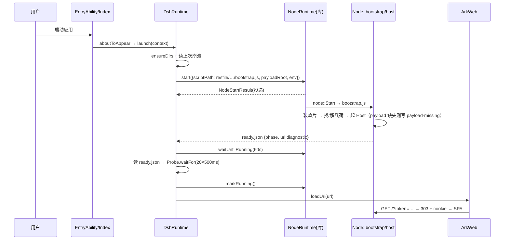

# 整体架构（ARCHITECTURE.md）

> 工程：`dsh-desktop-ark`
> 版本：v0.1（`000-scaffold`）
> 状态：**as-built**（`000-scaffold` 实现的部分）+ 标注 `planned` 的后续模块。
> 依据：`docs/000-工程规划.md` §4–§6。

---

## 1. 一句话架构

**ArkTS 外壳（UIAbility + ArkWeb + 系统能力） + 进程内 Node（`libnode.so` / `node::Start`）承载 dsh Host + 同源 loopback HTTP/WebSocket 数据面**，两者之间只有一个薄的文件信箱桥。

没有 Electron、没有第二个渲染引擎、没有自定义协议、没有 preload 注入。

---

## 2. 分层

```
┌─ HAP（org.fellow99.dsh.DshDesktopArk）────────────────────────────────────┐
│                                                                          │
│  ┌─ entry（ArkTS）─────────────────────────────────────────────────────┐ │
│  │ EntryAbility        UIAbility 生命周期；onPrepareToTerminate 不拦截    │ │
│  │ pages/Index.ets     窗口 + ArkWeb + 加载/错误/诊断覆盖层              │ │
│  │ app/DshRuntime.ets  启动编排状态机（idle→…→running）                  │ │
│  │ app/Probe.ets       HEAD 探活（20×500ms）                             │ │
│  │ host/HostCapabilities.ets  能力面注册（JSON 进出、永不抛）             │ │
│  │ common/Constants.ets       路径/超时/名字的单一事实源                 │ │
│  └───────────────▲────────────────────────────────────┬────────────────┘ │
│                  │ loadUrl(http://127.0.0.1:P/?token) │ 文件信箱（宿主桥）│
│  ┌───────────────┴────────────────────────────────────▼────────────────┐ │
│  │ Node（进程内 detached 线程，32 MB 栈）                                │ │
│  │  payload/bootstrap.js  唯一解包者 + 垫片安装 + 异常兜底               │ │
│  │  payload/host.js       载入 profile → runProfile → ready 上报         │ │
│  │  dsh Host              webserver + /api + connection + 工具/会话/模型 │ │
│  └─────────────────────────────────────────────────────────────────────┘ │
│                                                                          │
│  资源：resfile/dsh-payload/{bootstrap.js,host.js,dsh.version,dsh.tar.gz}  │
│        libs/arm64-v8a/{libnode.so,libc++_shared.so}                       │
└──────────────────────────────────────────────────────────────────────────┘
```

---

## 3. 进程与线程模型

| 实体 | 归属 | 约束 |
|---|---|---|
| ArkTS UI 线程 | 应用主线程 | **绝不 `dlopen`**（否则 `APP_INPUT_BLOCK`） |
| Node 线程 | 库创建（detached，32 MB 栈） | `node::Start` **每进程一次**；返回即 `exited`，不可重启 |
| stdio reader 线程 | 库 | `dup2` 后与 ArkWeb 原生输出共享 fd，只能排空 |
| ArkWeb 渲染进程 | 系统 | 与 Host 同机 loopback；cookie 由 ArkWeb 自己管理 |
| 应用实例 | 单例 | `launchType: singleton`；多实例会争 `filesDir` 与端口 |

---

## 4. 启动时序（as-built）



**失败分支**：任一阶段失败 → `markFailed(reason)` → UI 错误页（阶段、错误、日志尾、一键重启应用）。

---

## 5. 数据面与鉴权

- 上行：`fetch('/api/<method>')`；下行：`WebSocket('/api/events.*')`，均同源。
- 首次进入：`authenticatedUrl` 带一次性 token → `frontend-static` 交给 `ctx.connection.authorizeIndex` → **303 + 绑定 host:port 的签名 cookie**（HttpOnly / SameSite=Strict）。
- 壳不参与鉴权：不解析 token、不写 cookie、不改 `Host`/`Origin`。
- 端口随机（`--port 0`）：避免冲突，同时让 cookie audience 每次启动不同。

---

## 6. 状态机（DshRuntime）

```
idle → preparing → starting → waiting → probing → ready → running
                        │          │         │
                        └──────────┴─────────┴──→ failed（终态，需重启应用）
running → stopping → stopped
```

| 阶段 | 动作 | 失败处理 |
|---|---|---|
| `preparing` | `ensureDirs`；记录上次 `last-crash.json` | `failed` |
| `starting` | `NodeRuntime.start(...)` | 展示 `code/message` |
| `waiting` | `waitUntilRunning(START_TIMEOUT_MS)` | 日志尾 + `failed` |
| `probing` | 读 `ready.json` → `Probe.waitFor` | 附 HTTP 结果 + `failed` |
| `ready` | `markRunning()` + `loadUrl` | 页面错误页 |
| `running` | 正常使用 | — |
| `stopping` | `NodeRuntime.shutdown(reason)` | 2 s 后随应用退出 |

---

## 7. 目录与模块映射

| 目录 | 模块编号 | 职责 |
|---|---|---|
| `AppScope/`、`build-profile.json5`、`hvigorfile.ts` | `108` | 应用标识、SDK 目标、签名注入 |
| `entry/src/main/ets/entryability`、`pages` | `103` | 窗口与 ArkWeb 外壳 |
| `entry/src/main/ets/app`、`common` | `101` | 启动编排、探活、路径常量 |
| `entry/src/main/ets/host` | `104` | 宿主能力面（宿主桥） |
| `payload/`、`profiles/`、`packages/` | `102`、`105` | 载荷管线、profile/bundle 与 seam 插件 |
| `entry/src/main/resources/resfile/dsh-payload` | `102` | 随包载荷（脚本 + tar.gz + 版本） |
| `scripts/` | `102`、`108` | 构建、装配、打包、门禁、签名 |

---

## 8. 已实现 / 规划

| 能力 | 状态 | 模块 |
|---|---|---|
| 应用骨架可编译、可安装 | **implemented** | `101`、`103`、`108` |
| Node 启动 + `ready.json` 回读 + 探活 + `loadUrl` | **implemented** | `101` |
| 载荷自解包 + 幂等 marker + 异常兜底 | **implemented**（无归档时降级为 `payload-missing`） | `102` |
| 平台垫片 5 条 | **implemented**（`fs.link` / `fs.symlink` / `flock` / `sharp` / `node:sqlite`） | `102` |
| 宿主能力面（14 项） | **部分 implemented**（facts/perm/log/openExternal 已接；picker/notify/image 为 `not-implemented` 占位） | `104` |
| `ohos` profile + `@dsh-ohos/bundle` | **implemented**（YAML 层）；seam 插件为 `planned` | `105` |
| 四主目录 workspace-picker | **planned** | `106` |
| 诊断端点 `/_ohos/facts` | **planned** | `107` |
| 双发行线 / 上架材料 | **planned** | `108` |

---

## 9. 关键架构决策（与 000 §14 一致）

| # | 决策 | 结果 |
|---|---|---|
| A1 | 渲染用系统 ArkWeb，不打包 Chromium | 体积与合规成本最低；loopback 已验证 |
| A2 | 适配走上游 seam，不 patch 源码 | 升级成本低；垫片白名单化 |
| A3 | 页面直连 Host（同源），不注入 preload | 鉴权只在 Host；壳零凭据逻辑 |
| A4 | ArkTS ↔ Node 走文件信箱 | NAPI addon 路径未闭环；信箱 ~2 ms 足够 |
| A5 | 载荷由 Node 自解包 | 「谁写谁读」：ArkTS 解出的文件 Node 读不到 |
| A6 | 单实例 + 随机端口 | `node::Start` 只能一次；避免端口冲突导致进程 abort |
